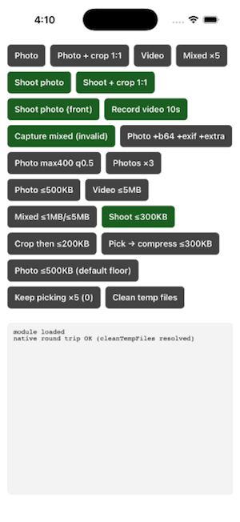

# react-native-media-picker-kit

Pick photos and videos in React Native — from the gallery **without asking for a single runtime permission**, straight from the camera, cropped, or compressed to a size your backend accepts — all in the same call. Built as a TurboModule for the New Architecture.

[](https://www.npmjs.com/package/react-native-media-picker-kit)
[](src/types.ts)
[](https://www.npmjs.com/package/react-native-media-picker-kit)
[](./LICENSE)


## See it in action

<table>
  <tr>
    <td align="center"><br />Pick</td>
    <td align="center"><br />Pick several</td>
    <td align="center"><br />Crop</td>
    <td align="center"><br />Camera</td>
    <td align="center"><br />Keep earlier picks</td>
  </tr>
</table>

Recorded from the [example app](example), which has a button for every option.

## Features

| Feature | Guide |
|---|---|
| Pick photos, videos, or both from the gallery, with **no runtime permission** on either platform | [Picking](docs/picking.md) |
| Take a photo or record a video, with nothing to declare on Android | [Camera](docs/camera.md) |
| Crop after a pick or a shot, without adding another library | [Cropping](docs/cropping.md) |
| Compress images and video to a size your backend accepts, with progress and cancel. Nothing under 10 MB is compressed unless you lower `minimumFileSizeForCompress` | [Compression](docs/compression.md) |
| Reopen the gallery with earlier picks still ticked, and learn which ones the user unticked | [Keeping earlier picks selected](docs/preselection.md) |
| Resize and re-encode on the native side (`maxWidth`, `maxHeight`, `quality`, `forceJpg`) | [Picking](docs/picking.md#resize-and-re-encode-on-the-way-out) |
| EXIF, base64, and the asset's library id | [Metadata](docs/metadata.md) |
| Every asset is a real `file://` in the app's cache, never a `content://` URI, with an API to clean up | [Temp files](docs/temp-files.md) |
| Expo config plugin that writes the iOS keys for you | [Expo](docs/expo.md) |
| Fully typed, and **nothing ever throws**: a cancel is a result, not an error | [API reference](docs/api.md) |

Not yet: saving to the user's photo library.

## Install

```sh
npm install react-native-media-picker-kit
# or: yarn add react-native-media-picker-kit

cd ios && pod install
```

Expo projects install and prebuild instead — the bundled config plugin writes the iOS keys for you:

```sh
npx expo install react-native-media-picker-kit
npx expo prebuild
```

Needs React Native **0.79+** with the New Architecture on (`newArchEnabled=true`), Android
`minSdkVersion` 24+, iOS 15.1+. There is no legacy-architecture fallback, and Expo Go cannot load it —
you need a development build. See [Expo](docs/expo.md).

## Quick start

```ts
import { pickMedia, MediaType } from "react-native-media-picker-kit"

const result = await pickMedia({
  mediaType: MediaType.photo,
})

if (result.didCancel) return
if (result.errorCode) {
  console.warn(result.errorMessage)
  return
}

const [asset] = result.assets
console.log(asset.uri) // file:///.../photo.jpg
```

That is the whole setup. No permission request, no `Info.plist` key, no manifest entry — the system
picker runs out of process and hands back only what the user chose. Nothing ever throws: a cancel is
a result, not an error.

### Send it to your backend

Every asset is a real file with the three fields `FormData` wants:

```ts
const body = new FormData()
body.append("file", {
  uri: asset.uri,
  name: asset.fileName,
  type: asset.type,
} as any)

await fetch("https://api.example.com/upload", { method: "POST", body })
```

## Comparison

The option and result shapes are a merge of the two libraries most people reach for, with the inconsistencies between them resolved.

|                       | react-native-media-picker-kit                                   | react-native-image-picker                                       | react-native-image-crop-picker                                                    |
| --------------------- | --------------------------------------------------------------- | --------------------------------------------------------------- | --------------------------------------------------------------------------------- |
| Cropping              | Built in — `cropping: true` on a pick or a capture              | Not supported                                                   | Built in                                                                          |
| Cancelling            | Resolves with `didCancel: true`                                 | Resolves with `didCancel: true`                                 | **Rejects** — every call site needs a `catch` that string-matches the cancel code |
| Android gallery video | Real `file://` copied into app cache                            | Read-only `content://` URI, which breaks uploads and `fs` calls | Real file                                                                         |
| `duration` units      | Milliseconds on both platforms                                  | Seconds                                                         | Milliseconds                                                                      |
| Asset field names     | One shape everywhere — `uri` / `fileName` / `fileSize` / `type` | `uri` / `fileName` / `fileSize` / `type`                        | `path` / `filename` / `size` / `mime`                                             |
| Extra Android setup   | None                                                            | None                                                            | Add the JitPack repo to your root `build.gradle` for uCrop                        |
| Architecture          | New Architecture only (TurboModule)                             | Both, with a legacy fallback                                    | Both                                                                              |

Reflects the behaviour these libraries document and that this package was built to reconcile — verify against their current releases before relying on a row.

## Documentation

- [**API reference**](docs/api.md): every option, the `Asset` shape, error codes, and all seven exports.
- [Picking](docs/picking.md): one or many, photos and video, resizing, and what comes back.
- [Camera](docs/camera.md): photos, video, the front camera, and the one permission iOS needs.
- [Cropping](docs/cropping.md): sizing, free-form vs aspect-locked, and what the cropper can't do.
- [Compression](docs/compression.md): target file sizes for images and video, and what it costs.
- [Keeping earlier picks selected](docs/preselection.md): `preselected`, `deselected`, and what each platform can show.
- [Metadata](docs/metadata.md): EXIF, base64, and the extra fields.
- [Permissions](docs/permissions.md): why the gallery needs none, and the one camera key that isn't optional.
- [Expo](docs/expo.md): the bundled config plugin and development builds.
- [Temp files](docs/temp-files.md): where assets live and how to clean them up.
- [Troubleshooting](docs/troubleshooting.md): autolinking, older Android, and the Xcode `fmt` build failure.
- [Example app](example): a runnable project with a button per option.
- [Contributing](CONTRIBUTING.md): code layout, running the tests, and releasing.

[Report a bug](https://github.com/Fahme94/react-native-media-picker/issues)

## License

MIT © [Ahmed Fahmy](https://github.com/Fahme94)
