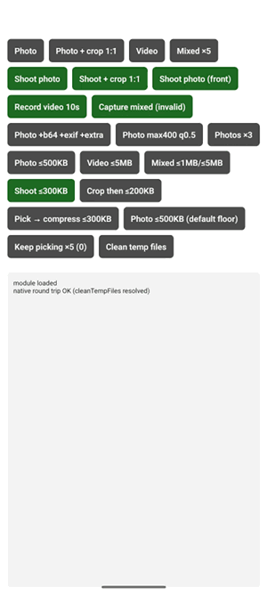

# Taking a photo or video

`captureMedia` opens the system camera and returns the shot in the same shape `pickMedia` uses, so
the code that handles the result is the same. It always returns **at most one asset**.



## A photo

```ts
import { captureMedia, MediaType, CameraType } from 'react-native-media-picker-kit';

const result = await captureMedia({
  mediaType: MediaType.photo,
  cameraType: CameraType.back,
});

if (result.didCancel) return;
const [photo] = result.assets;
```

## A video

```ts
import { VideoQuality } from 'react-native-media-picker-kit';

const result = await captureMedia({
  mediaType: MediaType.video,
  durationLimit: 30, // seconds
  videoQuality: VideoQuality.high,
});
```

The recording comes back as MP4 on both platforms. iOS records QuickTime, so the clip is rewrapped as
`.mp4` on the way out, without re-encoding it.

`mediaType: 'mixed'` is rejected with `invalid_options`. Android has one camera action for photos and
another for video, with nothing that offers both, so it cannot behave the same on both platforms.

## Options

| Option | Default | What it does |
|---|---|---|
| `mediaType` | `'photo'` | `'photo'` or `'video'`. |
| `cameraType` | `'back'` | `'front'` opens the front camera. Exact on iOS; on Android it is a hint the camera app may ignore, because Android has no standard way to choose the lens. |
| `durationLimit` | none | Maximum recording length in seconds. |
| `videoQuality` | `'high'` | `'low'` or `'high'`. |

Everything else works as it does for a pick: `maxWidth`, `maxHeight`, `quality` and `forceJpg` are
applied to the photo, `maxImageFileSize` and `maxVideoFileSize` compress it ([Compression](compression.md)),
and `cropping: true` shows the crop screen straight after the shot ([Cropping](cropping.md)).

## Permissions

- **iOS** needs `NSCameraUsageDescription` in `Info.plist`, and `NSMicrophoneUsageDescription` to
  record video with sound. The [Expo plugin](expo.md) writes both.
- **Android** needs nothing: the camera app takes the picture, not your app. The one exception is an
  app that declares the `CAMERA` permission itself (often through another library); Android then
  requires it to be granted, so the library asks for it first.

A user who has denied camera access gets `errorCode: 'permission'` instead of a black viewfinder. See
[Permissions](permissions.md).

## Errors you can get

| `errorCode` | When |
|---|---|
| `camera_unavailable` | No camera on the device, a video request on a camera that cannot record (every iOS simulator), or no camera app on Android. |
| `permission` | Camera access was denied. |
| `invalid_options` | `mediaType: 'mixed'`, `preselected`, or a negative `durationLimit`. |
| `picker_busy` | A picker, camera or cropper from an earlier call is still open. |
