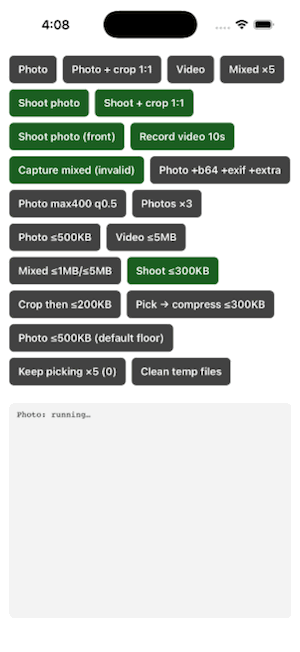

# Picking from the gallery

`pickMedia` opens the system photo picker and hands back real files in your app's cache. It needs
**no runtime permission** on either platform: the picker runs in its own process and only returns what
the user chose.

<p>
  
  
</p>

## One photo

```ts
import { pickMedia, MediaType } from 'react-native-media-picker-kit';

const result = await pickMedia({ mediaType: MediaType.photo });

if (result.didCancel) return;
if (result.errorCode) return console.warn(result.errorMessage);

const [photo] = result.assets;
photo.uri; // file:///.../rn_media_picker/....jpg
```

A cancel is a result with `didCancel: true`, not an error, and nothing ever throws.

## Several, video, or both

```ts
await pickMedia({ mediaType: MediaType.photo, selectionLimit: 5 });
await pickMedia({ mediaType: MediaType.video });
await pickMedia({ mediaType: MediaType.mixed, selectionLimit: 0 }); // 0 = unlimited
```

Assets come back **in the order the user picked them**, on both platforms.

## Resize and re-encode on the way out

```ts
await pickMedia({ maxWidth: 1280, maxHeight: 1280, quality: 0.8 });
```

| Option | Default | What it does |
|---|---|---|
| `maxWidth`, `maxHeight` | none | Fit the image inside this box. It is never enlarged. |
| `quality` | `1` | JPEG quality, 0 to 1. Below 1 the image is re-encoded. |
| `forceJpg` | `true` | Convert HEIC, HEIF and PNG to JPEG. GIFs are left alone, because re-encoding would drop the animation. |

These apply to images only. To cap the size in bytes instead, see [Compression](compression.md).
`fileName` and `type` always describe the bytes actually written, so a PNG that became a JPEG is
reported as `photo.jpg` and `image/jpeg`.

## Adding to an earlier pick

Pass what you already hold as `preselected` and the picker opens with it ticked. You get back only the
new picks, plus anything the user unticked. See [Keeping earlier picks selected](preselection.md).

## What you get back

Every asset is a real `file://` path in the app's cache, ready for `FormData` or any file API. On
Android the picker's `content://` grant is copied out before it expires, so an upload later on never
fails with a permission error.

```ts
const body = new FormData();
body.append('file', { uri: photo.uri, name: photo.fileName, type: photo.type } as any);
```

`originalPath` identifies the item in the user's library: a `content://` URI on Android, the
`PHAsset` identifier on iOS. It is what `preselected` takes. The full shape is in the
[API reference](api.md#asset); [Metadata](metadata.md) covers EXIF, base64 and the extra fields.

Files stay in the cache until you remove them. See [Temp files](temp-files.md).

## Platform notes

| | iOS | Android |
|---|---|---|
| Picker | `PHPickerViewController` (iOS 14+) | System photo picker; the document picker on devices without it |
| Unlimited (`selectionLimit: 0`) | No cap | Capped at 100 by the photo picker |
| `restrictMimeTypes` | Ignored | Narrows the document picker fallback, e.g. `['image/jpeg']` |
| `presentationStyle` | `pageSheet`, `fullScreen` and the other `UIModalPresentationStyle`s | Ignored |
